

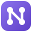

# Nodus

**Tus finanzas, en tu computadora.**

Finanzas personales con el diseño de una app moderna y la privacidad de un archivo que es solo tuyo. 
Sin nube, sin cuentas, sin suscripciones.

[English](README.md) · **Español**

### [Descargar para Windows](https://github.com/germanricco/Nodus/releases/latest)

<picture>
  <source media="(prefers-color-scheme: dark)" srcset="docs/images/dashboard-full-dark.png">
  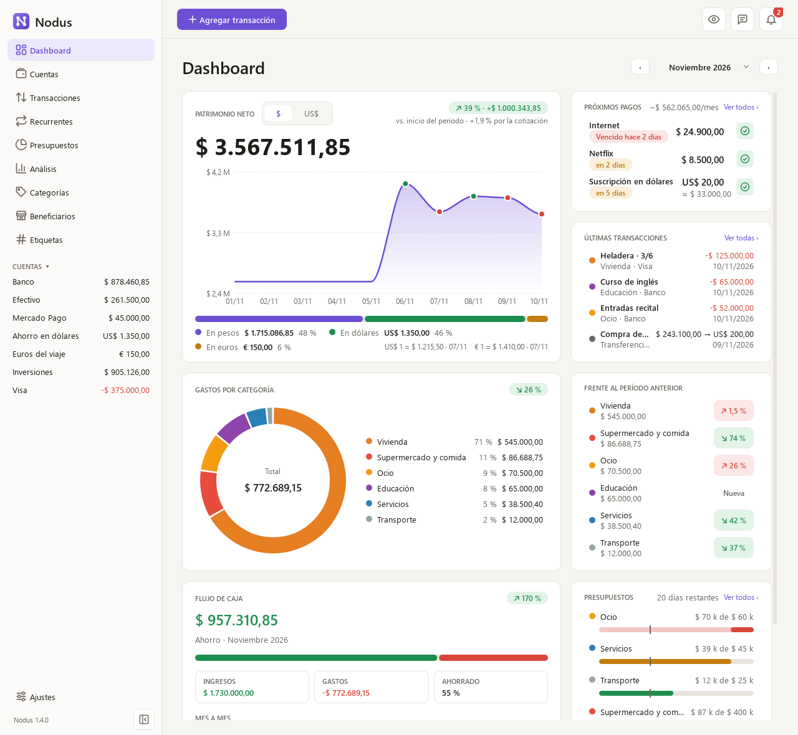
</picture>

## Por qué Nodus

Las aplicaciones de finanzas personales que se ven bien suelen vivir en la nube: piden crear una cuenta, cobran una suscripción y guardan tu historial financiero en servidores ajenos. Las que funcionan en tu computadora, en cambio, muchas veces parecen de otra época. Nodus busca el punto medio que faltaba: una interfaz cuidada y fluida que corre entera en tu máquina, con todos tus datos en un único archivo que puedes copiar, respaldar o mover cuando quieras.

Nació para quien lleva sus cuentas en pesos y en dólares. Cada cuenta tiene su moneda, las compras de dólares guardan lo que salió y lo que entró, y el patrimonio neto se ve en las dos monedas con la cotización que elijas: MEP, blue u oficial. *Nodus* significa «nodo» en latín, el punto donde las líneas se cruzan, y esa es la idea: tu computadora es el único lugar donde tus datos financieros se encuentran.

## Qué puedes hacer

### Ver tu situación de un vistazo
El dashboard responde las preguntas de siempre: cuánto tienes, cómo vienes y en qué se fue el dinero. Muestra la evolución de tu patrimonio neto, tus próximos pagos, los gastos por categoría comparados con el período anterior, el flujo de caja mes a mes y tus presupuestos. Eliges el período (este mes, los últimos 3, 6 o 12 meses, el año o cualquier rango de fechas) y un clic en una categoría te lleva a sus movimientos. Si alguien mira tu pantalla, el ojo de la barra superior oculta tus saldos y tu patrimonio neto, y el panel lateral se contrae a sus íconos cuando quieres más espacio.

<picture>
  <source media="(prefers-color-scheme: dark)" srcset="docs/images/dashboard-dark.png">
  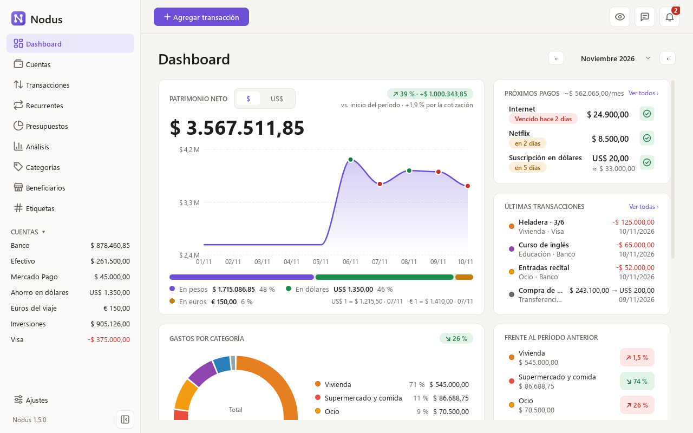
</picture>

### Llevar tus cuentas en pesos y en dólares
Registras cada lugar donde tienes dinero, sea el banco, el efectivo, una billetera virtual como Mercado Pago, los ahorros en dólares o una tarjeta, y los saldos se calculan siempre a partir de los movimientos. Las ordenas arrastrándolas, y el panel lateral sigue ese orden. Cuando compras dólares, Nodus guarda los dos montos y te muestra la cotización que realmente obtuviste. También puedes tener euros y pesos chilenos, para un viaje o unos ahorros afuera, y se suman a tu patrimonio neto como todo lo demás. Las cotizaciones del día pueden llegar solas, el dólar que elijas y el euro y el peso chileno oficiales, o las cargas a mano. Los ahorros y las inversiones crecen solos, con intereses o precios: anotas cuánto vale hoy una, como lo muestra su app, y Nodus guarda la diferencia como rendimiento, que mueve tu saldo y tu patrimonio neto sin contar como ingreso.

<picture>
  <source media="(prefers-color-scheme: dark)" srcset="docs/images/accounts-dark.png">
  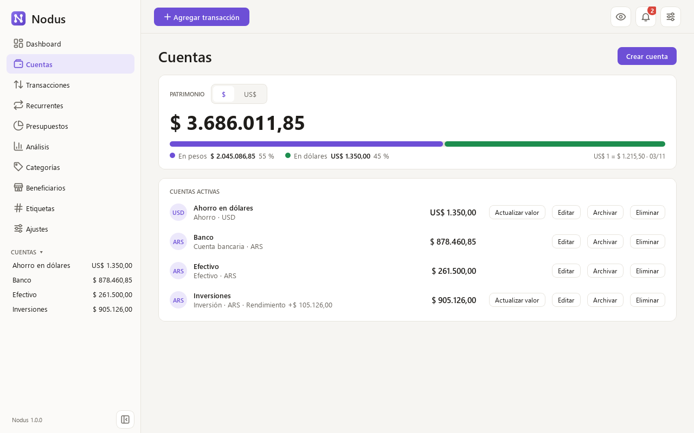
</picture>

### Registrar y encontrar tus movimientos
Un mismo formulario sirve para gastos, ingresos y transferencias, y ya trae la última cuenta que usaste. La lista se filtra por período, cuenta, categoría, beneficiario, etiqueta, tipo o texto, suma al pie los movimientos que muestra, y lo que ves se exporta a un archivo que se abre en Excel. Cada lista de filtros termina con un atajo para editar sus cuentas, categorías, beneficiarios o etiquetas. Cada fila de Nodus tiene un menú «⋯», que también se abre con el clic derecho, con todo lo que puedes hacer con ella; marca varias transacciones para cambiarles la categoría o eliminarlas juntas, y varios beneficiarios o etiquetas para unirlos o eliminarlos.

<picture>
  <source media="(prefers-color-scheme: dark)" srcset="docs/images/transactions-dark.png">
  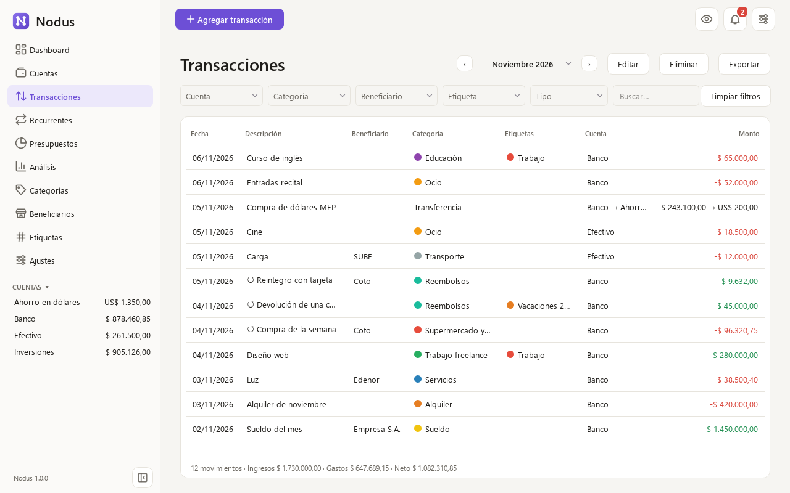
</picture>

### Saber a quién va tu dinero
Cada gasto o ingreso puede decir a quién le pagaste o quién te pagó: el supermercado, la empresa de luz, tu empleador. Escribes unas letras para elegirlo, o un nombre nuevo para sumarlo, y Nodus completa la categoría que sueles usar con él. La página Beneficiarios muestra cuántos movimientos y cuánto dinero fue o vino de cada uno, así que una pregunta como «¿cuánto gasto en el supermercado?» se responde con un clic. Los repetidos, como «Coto» y «Coto Online», se pueden unir en uno.

<picture>
  <source media="(prefers-color-scheme: dark)" srcset="docs/images/payees-dark.png">
  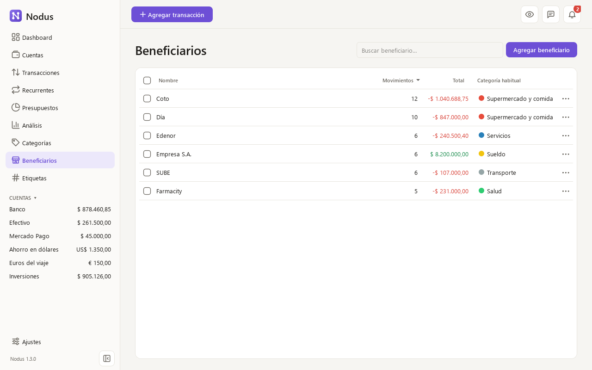
</picture>

### Agrupar lo que va junto
Un viaje mezcla pasajes, hotel y comidas; un trabajo aparte trae ingresos y los gastos que lo acompañan. Las etiquetas agrupan movimientos de distintas categorías: escribes unas letras en el formulario para elegir una, o un nombre nuevo para crearla, y cada movimiento lleva las que necesite. La página Etiquetas muestra cuántos movimientos y cuánto dinero suma cada una, la lista de movimientos se filtra por etiqueta y Análisis también reparte tus gastos por etiqueta. Puedes renombrarlas, cambiarles el color, unirlas o borrarlas sin perder ningún movimiento. Etiquetas y categorías aceptan cualquier color: además de las muestras de siempre, el «+» abre un círculo cromático, que también acepta un código hexadecimal.

<picture>
  <source media="(prefers-color-scheme: dark)" srcset="docs/images/tags-dark.png">
  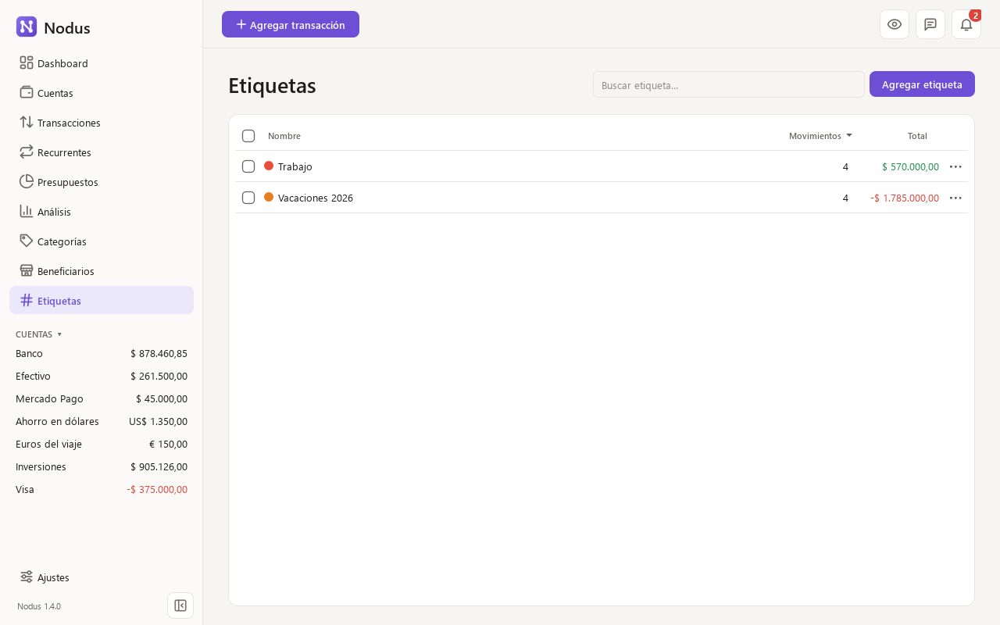
</picture>

### Contar los reembolsos como lo que son
Cuando un comercio te devuelve dinero o un amigo te paga su parte, vinculas ese ingreso con el gasto que devuelve. Nodus lo cuenta entonces como un gasto menor, en la categoría del gasto original y en el mes en que volvió el dinero, en lugar de como un ingreso, así que tus presupuestos, el dashboard y Análisis muestran lo que realmente gastaste. La lista marca los dos lados y, al editar el gasto, ves cuánto te devolvieron.

<picture>
  <source media="(prefers-color-scheme: dark)" srcset="docs/images/transaction-dialog-refund-dark.png">
  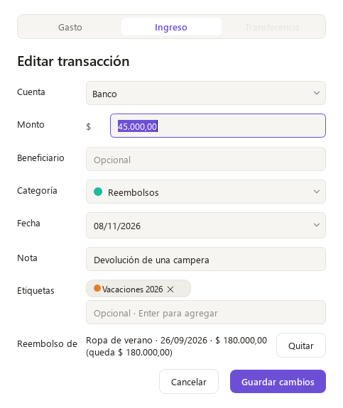
</picture>

### No olvidarte de lo que pagas todos los meses
Anotas el alquiler, los servicios o las suscripciones una sola vez, y Nodus te muestra cuánto suman por mes, qué vence pronto y qué está atrasado. Pagar uno toma dos clics: el gasto queda registrado y el cargo pasa a su próxima fecha. Una suscripción con precio fijo en dólares puede pagarse desde una cuenta en pesos: Nodus estima los pesos con la cotización de tu último pago, impuestos de la tarjeta incluidos, y tú anotas lo que realmente salió.

<picture>
  <source media="(prefers-color-scheme: dark)" srcset="docs/images/recurring-dark.png">
  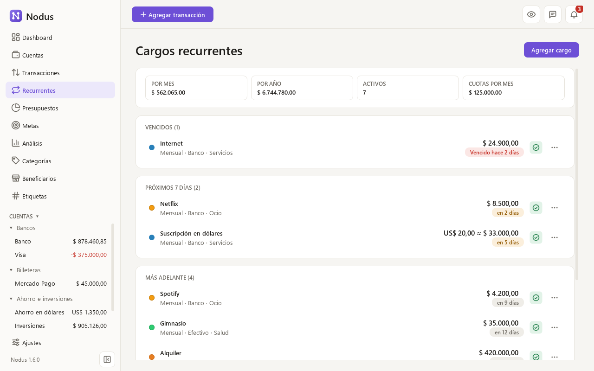
</picture>

### Ponerle un límite a lo que gastas
Defines un presupuesto mensual para las categorías que quieres cuidar y ves cuánto llevas y cuánto te queda. La barra se pone amarilla cuando gastas más rápido de lo que avanza el mes y roja cuando te pasas, a tiempo para frenar. Para elegir el límite, Nodus te sugiere tu promedio de los últimos meses.

<picture>
  <source media="(prefers-color-scheme: dark)" srcset="docs/images/budgets-dark.png">
  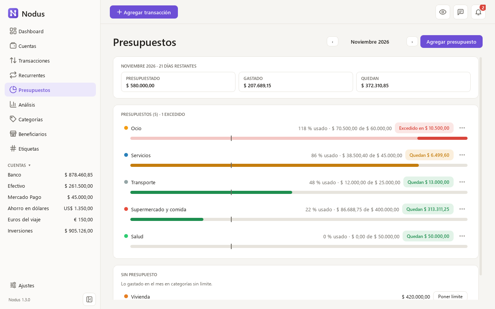
</picture>

### Mirar el año completo
La página Análisis toma distancia: por defecto, los últimos doce meses. Tendencias muestra tus gastos, ingresos o ahorro mes a mes, apilados por categoría y frente a tu promedio mensual, junto con en qué se fue el dinero por categoría, por beneficiario y por etiqueta. Flujo de caja pone lado a lado ingresos, gastos, ahorro y tasa de ahorro con los del período anterior, y Patrimonio neto sigue cómo creció lo que tienes, fin de mes tras fin de mes, en pesos o en dólares. Un clic en cualquier barra o fila te lleva a los movimientos que la forman.

<picture>
  <source media="(prefers-color-scheme: dark)" srcset="docs/images/analysis-trends-dark.png">
  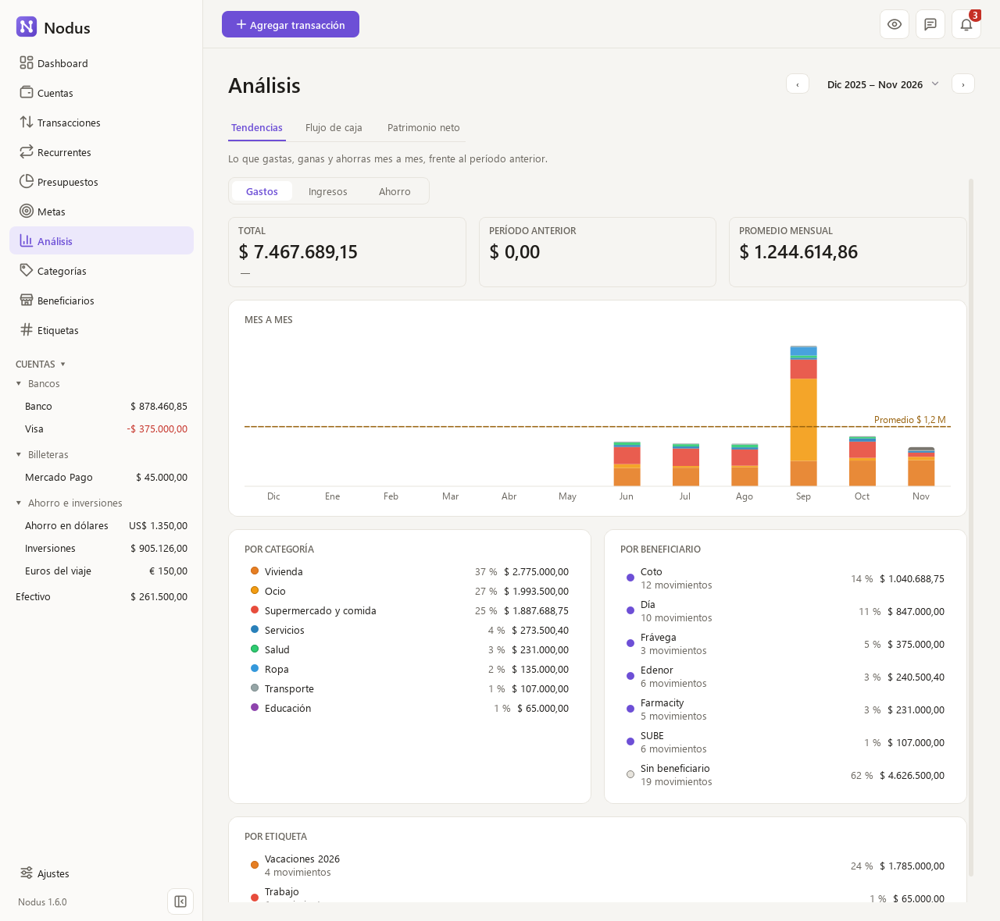
</picture>

### Enterarte de lo importante
Una campana junta lo que merece tu atención: un pago que vence, un presupuesto excedido, una cotización vieja o una versión nueva para instalar. Además, cada día Nodus guarda una copia de seguridad de tus datos, y puedes restaurar cualquiera desde Ajustes. Todo funciona en tema claro u oscuro.

<picture>
  <source media="(prefers-color-scheme: dark)" srcset="docs/images/notifications-dark.png">
  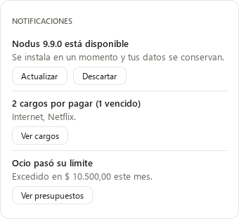
</picture>

## Tus datos son tuyos

Todo vive en un archivo de tu computadora, `%APPDATA%\Nodus\nodus.db`, con las copias diarias al lado, en `%APPDATA%\Nodus\backups`. Actualizar o desinstalar Nodus no lo toca. La aplicación solo se conecta a internet para dos cosas, y puedes desactivar las dos: ver en GitHub si hay una versión nueva, sin enviar ningún dato tuyo (el instalador solo se descarga cuando tocas «Actualizar»), y traer las cotizaciones de [DolarApi](https://dolarapi.com) si elegiste una fuente automática.

## Descargar e instalar

Nodus funciona en **Windows 10 y 11 de 64 bits**.

1. Descarga `Nodus-Setup-<versión>.exe` desde la [última versión publicada](https://github.com/germanricco/Nodus/releases/latest).
2. Ábrelo y sigue el asistente. Se instala solo para tu usuario, sin permisos de administrador, y queda en el menú Inicio.
3. Si Windows muestra «Windows protegió tu PC», haz clic en «Más información» y luego en «Ejecutar de todas formas». Aparece porque el instalador no tiene una firma comercial, que tiene un costo anual. Cada instalador se compila automáticamente en GitHub a partir del código de este repositorio.

Para actualizar, toca «Actualizar» cuando Nodus avise que hay una versión nueva: la descarga, comprueba que llegó entera, la instala sin preguntas y se vuelve a abrir, con tus datos intactos. (Si vienes de la 1.1.0 o anterior, instala la 1.2.0 encima una vez; desde ahí, alcanza con un clic.) Antes de instalar, Nodus te cuenta qué trae cada versión, y después de actualizar te muestra una vez qué cambió; la historia completa está en [CHANGELOG.md](CHANGELOG.md). Si quieres que te espere abierto cada mañana, activa «Abrir Nodus al iniciar Windows» en Ajustes; al desinstalarlo, esa opción se quita sola.

## Hoja de ruta

Nodus crece por versiones pequeñas y estables. La **v1.0**, la primera estable, incluye cuentas, transacciones, cotización del dólar, rendimiento de inversiones, dashboard, cargos recurrentes, presupuestos, beneficiarios, etiquetas, reembolsos, análisis, copias de seguridad y exportación. La **v1.1** sumó euros y pesos chilenos, billeteras virtuales, cuentas en el orden que quieras, cualquier color para categorías y etiquetas, abrir con Windows, enviar comentarios desde la aplicación y un resumen de las novedades después de cada actualización. Lo que viene:

- **v1.3 — Metas y grupos de cuentas:** ahorrar para algo concreto y agrupar bancos, inversiones y efectivo.
- **v1.4 — Inversiones:** una sección propia para seguirlas.

## Tecnología

Nodus está escrito en **Python**. La interfaz usa **PySide6**, la versión oficial de Qt para Python, que da aplicaciones nativas y rápidas sin cargar un navegador. Los datos se guardan en **SQLite**, una base de datos de un solo archivo que no necesita servidor. El instalador se arma con PyInstaller e Inno Setup.

## Contribuir

Las ideas y los reportes de errores son bienvenidos en [Issues](https://github.com/germanricco/Nodus/issues), o directo desde la aplicación con el globo de diálogo de la barra superior, que abre un formulario corto sin pedir cuenta. Para ejecutar Nodus desde el código, correr las pruebas o compilar el instalador, mira [CONTRIBUTING.md](CONTRIBUTING.md).

## Apoyar

Nodus es gratis y lo va a seguir siendo. Si te ayuda a ordenar tus finanzas y quieres devolver algo, puedes [invitarme un cafecito](https://cafecito.app/germanricco), también desde Ajustes en la aplicación.

## Agradecimientos

Las funciones y el diseño de Nodus se inspiran en [MoneyMatter](https://github.com/letehaha/moneymatter), una aplicación web de finanzas personales de código abierto. Nodus no reutiliza su código: reimplementa sus ideas para una aplicación de escritorio local.

## Licencia

Nodus es software libre bajo la [licencia MIT](LICENSE).

Hecho por [German Ricco](https://github.com/germanricco).
