

# Nodus

**Your finances, on your computer.**

Personal finance with the look of a modern app and the privacy of a file that is yours alone. 
No cloud, no accounts, no subscriptions.

**English** · [Español](README.es.md)

### [Download for Windows](https://github.com/germanricco/Nodus/releases/latest)

<picture>
  <source media="(prefers-color-scheme: dark)" srcset="docs/images/dashboard-full-dark.png">
  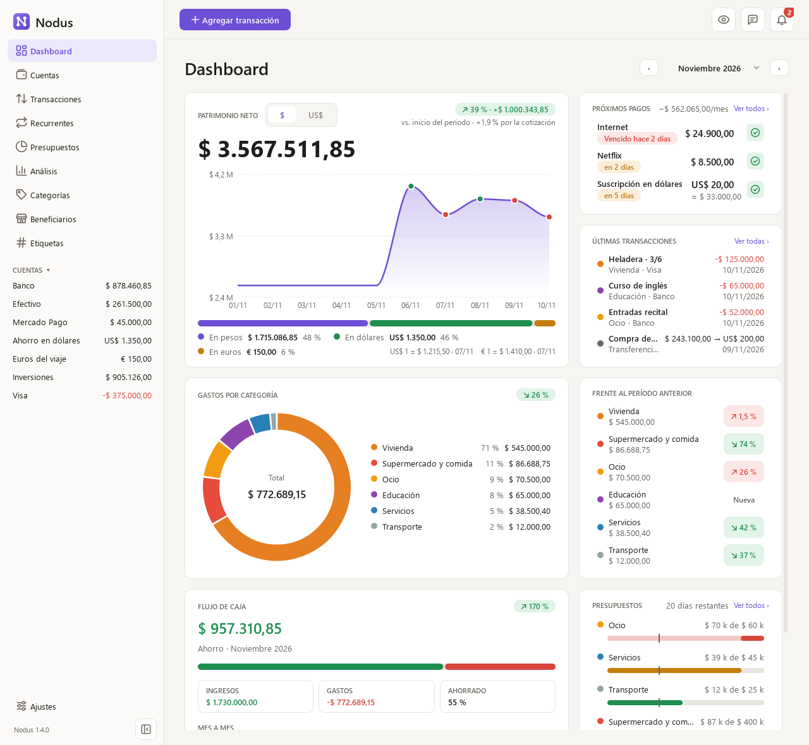
</picture>

> The app's interface is in Spanish: Nodus was built for people in Argentina who keep their money in both pesos and US dollars.

## Why Nodus

Personal finance apps that look good tend to live in the cloud: they ask you to sign up, charge a subscription and keep your financial history on someone else's servers. The ones that run on your own computer, on the other hand, often feel like software from another era. Nodus aims for the missing middle ground: a polished, fluid interface that runs entirely on your machine, with all your data in a single file you can copy, back up or move whenever you like.

It was born for people who manage money in pesos and dollars at the same time. Each account has its own currency, dollar purchases record both what went out and what came in, and your net worth shows in either currency at the exchange rate you choose. *Nodus* is Latin for "node", the point where lines meet, and that is the idea: your computer is the only place where your financial data comes together.

## What you can do

### See where you stand at a glance
The dashboard answers the usual questions: how much you have, how the month is going and where the money went. It shows how your net worth evolves, your upcoming payments, spending by category against the previous period, cash flow month by month and your budgets. Pick a period (this month, the last 3, 6 or 12 months, the year or any range of dates), and click a category to see its transactions. If someone is looking over your shoulder, the eye in the top bar hides your balances and net worth, and the sidebar folds down to its icons when you want more room.

<picture>
  <source media="(prefers-color-scheme: dark)" srcset="docs/images/dashboard-dark.png">
  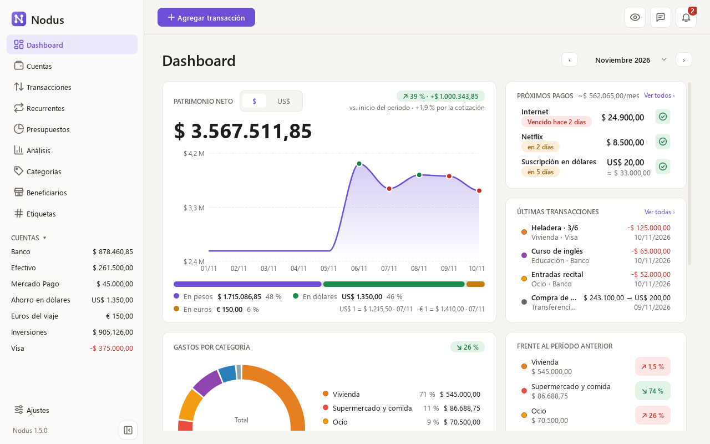
</picture>

### Keep accounts in pesos and dollars
Add every place where you keep money, from your bank, cash and virtual wallets like Mercado Pago to dollar savings or a credit card, and balances are always computed from your transactions. Drag them into the order you like, and the sidebar follows it. When you buy dollars, Nodus stores both amounts and shows the rate you actually got. Euros and Chilean pesos are welcome too, for travel money or savings abroad, and they add up to your net worth like everything else. Today's exchange rates can be fetched automatically, your choice of dollar plus the official euro and Chilean peso, or entered by hand. Savings and investments grow on their own, with interest or prices: write down what one is worth today, as its app shows it, and Nodus records the difference as a return that moves your balance and net worth without counting as income.

<picture>
  <source media="(prefers-color-scheme: dark)" srcset="docs/images/accounts-dark.png">
  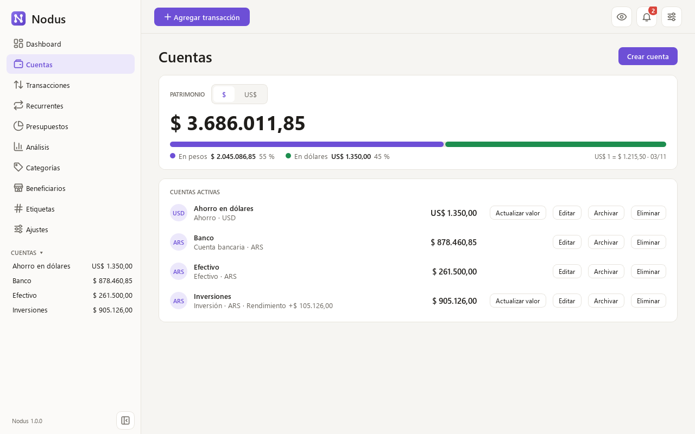
</picture>

### Record and find your transactions
One form covers expenses, income and transfers, and it starts on the account you used last. The list filters by period, account, category, payee, tag, type or text, adds up at the foot the transactions it shows, and whatever you see exports to a file that opens in Excel. Each filter list ends with a shortcut to edit its accounts, categories, payees or tags.

<picture>
  <source media="(prefers-color-scheme: dark)" srcset="docs/images/transactions-dark.png">
  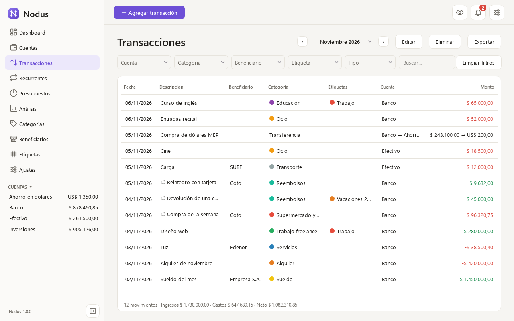
</picture>

### Know who your money goes to
Each expense or income can say who you paid or who paid you: the supermarket, the power company, your employer. Type a few letters to pick one, or a new name to add it, and Nodus fills in the category you usually use with it. The Payees page shows how many transactions and how much money went to or came from each one, so a question like "how much do I spend at the supermarket?" takes one click. Duplicates such as "Coto" and "Coto Online" can be merged into one.

<picture>
  <source media="(prefers-color-scheme: dark)" srcset="docs/images/payees-dark.png">
  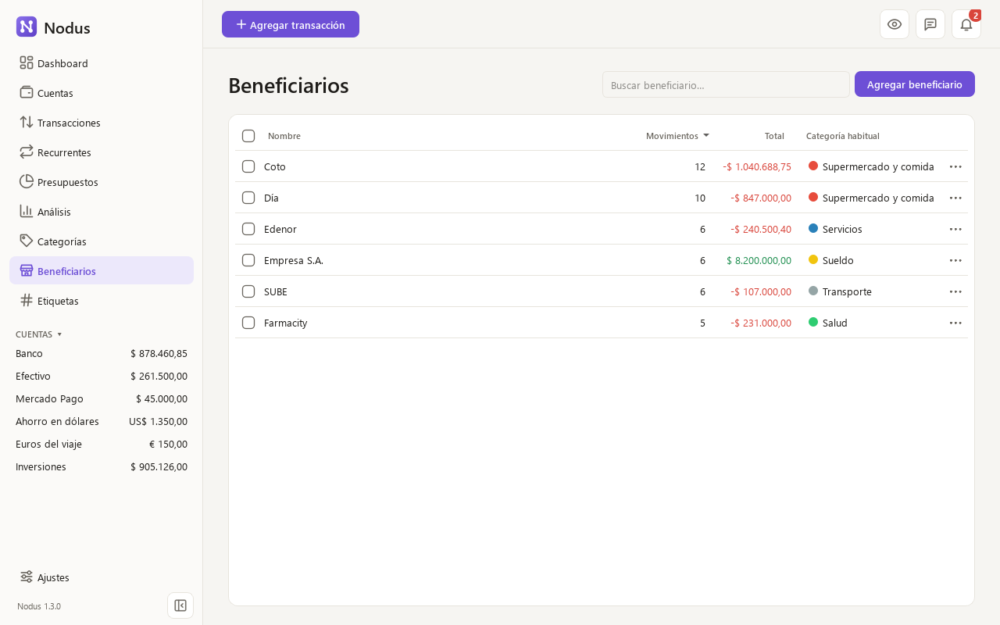
</picture>

### Tag what belongs together
A trip mixes flights, a hotel and meals; a side job brings income and the expenses that come with it. Tags group transactions across categories: type a few letters in the form to pick one, or a new name to create it, and give each transaction as many as it needs. The Tags page shows how many transactions and how much money each tag adds up to, the transactions list filters by tag, and Analysis splits your spending by tag too. Tags can be renamed, recolored, merged or deleted without losing a single transaction. Tags and categories take any color you like: beyond the ready-made swatches, a color wheel opens with the «+», and it also accepts a hex code.

<picture>
  <source media="(prefers-color-scheme: dark)" srcset="docs/images/tags-dark.png">
  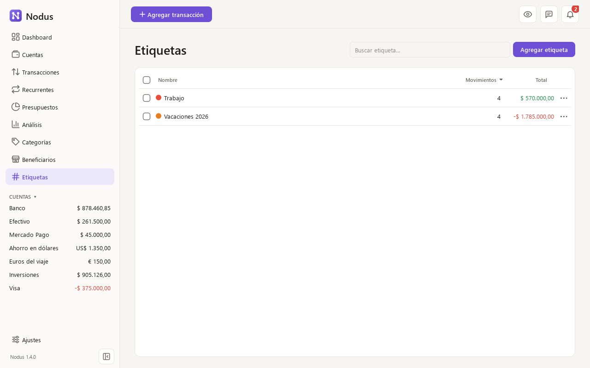
</picture>

### Count refunds for what they are
When a store gives your money back or a friend pays you their share, link that income to the expense it pays back. Nodus then counts it as less spending, in the category of the original expense and in the month the money came back, instead of as income, so your budgets, the dashboard and Analysis show what you really spent. The list marks both sides, and editing the expense shows how much of it was refunded.

<picture>
  <source media="(prefers-color-scheme: dark)" srcset="docs/images/transaction-dialog-refund-dark.png">
  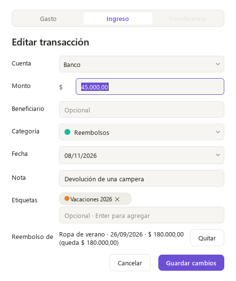
</picture>

### Never forget what you pay every month
Enter rent, utilities or subscriptions once, and Nodus shows what they add up to per month, what is due soon and what is overdue. Paying one takes two clicks: the expense is recorded and the charge moves on to its next date. A subscription with a fixed price in dollars can be paid from a peso account: Nodus estimates the pesos at the rate of your last payment, card taxes included, and you write down what actually came out.

<picture>
  <source media="(prefers-color-scheme: dark)" srcset="docs/images/recurring-dark.png">
  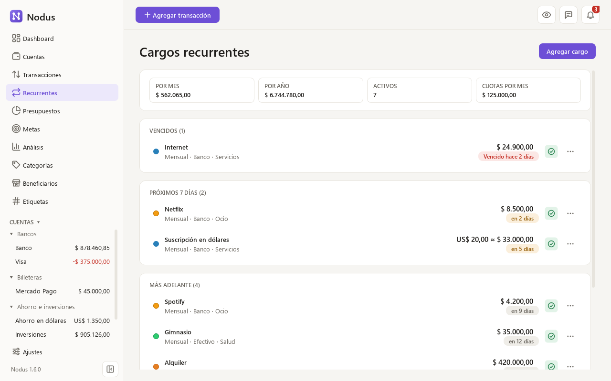
</picture>

### Put a limit on your spending
Set a monthly budget for the categories you want to watch and see how much you have spent and how much is left. The bar turns amber when you spend faster than the month goes by and red when you go over, early enough to slow down. To choose a limit, Nodus suggests your average of the last few months.

<picture>
  <source media="(prefers-color-scheme: dark)" srcset="docs/images/budgets-dark.png">
  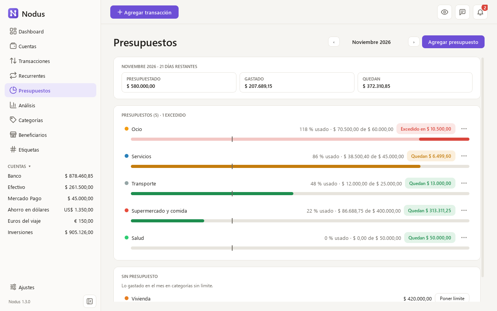
</picture>

### Look back over the year
The Analysis page takes the long view, the last twelve months by default. Trends shows your spending, income or savings month by month, stacked by category against your monthly average, along with where the money went by category, by payee and by tag. Cash flow puts income, expenses, savings and your savings rate side by side with the previous period, and Net worth follows how what you own grew, month end by month end, in pesos or in dollars. Click any bar or row to see the transactions behind it.

<picture>
  <source media="(prefers-color-scheme: dark)" srcset="docs/images/analysis-trends-dark.png">
  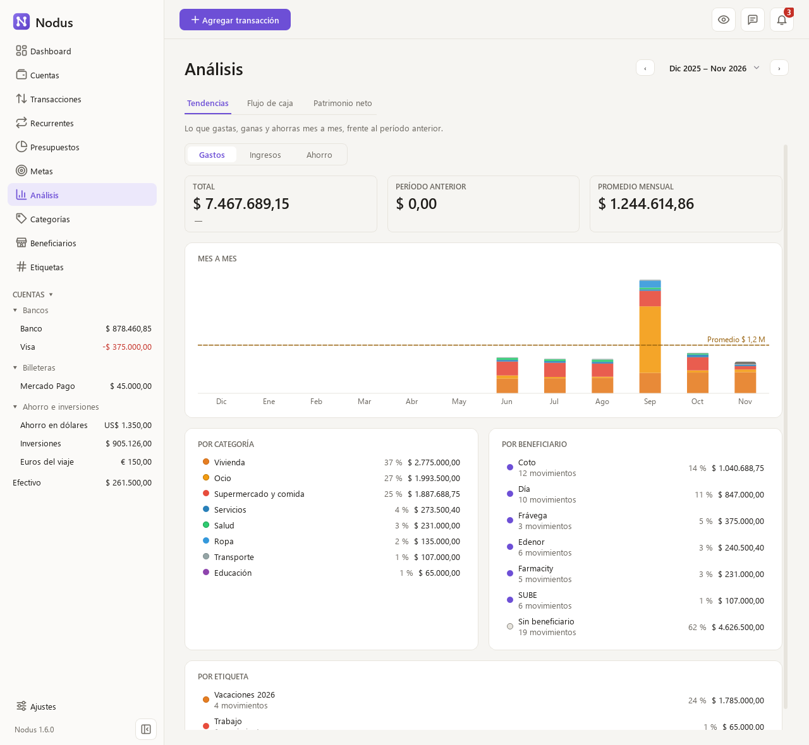
</picture>

### Hear about what matters
A bell gathers what needs your attention: a payment coming due, a budget passed, a stale exchange rate or a new version to install. Nodus also backs up your data every day, and you can restore any copy from Settings. Everything works in light or dark mode.

<picture>
  <source media="(prefers-color-scheme: dark)" srcset="docs/images/notifications-dark.png">
  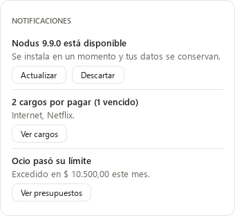
</picture>

## Your data stays yours

Everything lives in one file on your computer, `%APPDATA%\Nodus\nodus.db`, with the daily backups next to it in `%APPDATA%\Nodus\backups`. Updating or uninstalling Nodus never touches it. The app only goes online for two things, and you can turn both off: checking GitHub for a new version, without sending any of your data, and fetching exchange rates from [DolarApi](https://dolarapi.com) if you chose an automatic source.

## Download and install

Nodus runs on **64-bit Windows 10 and 11**.

1. Download `Nodus-Setup-<version>.exe` from the [latest release](https://github.com/germanricco/Nodus/releases/latest).
2. Open it and follow the wizard. It installs for your user only, without administrator rights, and shows up in the Start menu.
3. If Windows says "Windows protected your PC", click "More info" and then "Run anyway". The warning appears because the installer has no commercial code-signing certificate, which costs a yearly fee. Every installer is built automatically on GitHub from the code in this repository.

To update, install the new version over the old one: your data is kept. Nodus lets you know when a new version is out and what it brings, and after updating it shows once what changed; the full history is in [CHANGELOG.md](CHANGELOG.md) (in Spanish). If you want it waiting for you every morning, turn on «Abrir Nodus al iniciar Windows» in Settings, and uninstalling turns it off again.

## Roadmap

Nodus grows in small, stable releases. **v1.0**, the first stable one, covers accounts, transactions, dollar exchange rates, investment returns, the dashboard, recurring charges, budgets, payees, tags, refunds, analysis, backups and export. Coming next:

- **Goals and account groups:** saving for something specific, and grouping banks, investments and cash.

## Technology

Nodus is written in **Python**. The interface uses **PySide6**, the official Qt for Python, which gives fast native apps without shipping a browser. Data is stored in **SQLite**, a single-file database that needs no server. The installer is built with PyInstaller and Inno Setup.

## Contributing

Ideas and bug reports are welcome in [Issues](https://github.com/germanricco/Nodus/issues), or straight from the app with the speech bubble in the top bar, which opens a short form that needs no account. To run Nodus from source, run the tests or build the installer, see [CONTRIBUTING.md](CONTRIBUTING.md) (in Spanish).

## Support

Nodus is free and always will be. If it helps you keep your finances in order and you want to give something back, you can [buy me a coffee on Cafecito](https://cafecito.app/germanricco), also from Settings in the app.

## Acknowledgements

Nodus's features and design are inspired by [MoneyMatter](https://github.com/letehaha/moneymatter), an open-source personal finance web app. Nodus reuses none of its code: it reimplements its ideas as a local desktop application.

## License

Nodus is free software under the [MIT License](LICENSE).

Made by [German Ricco](https://github.com/germanricco).
